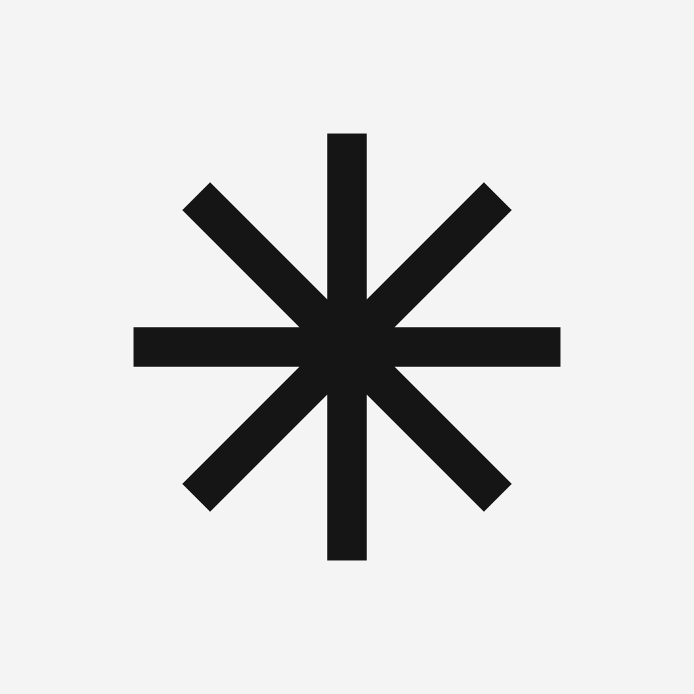
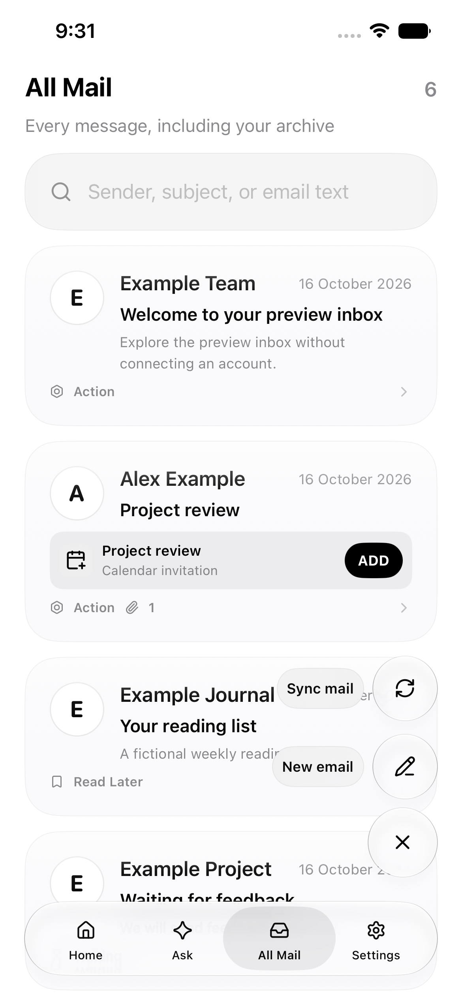
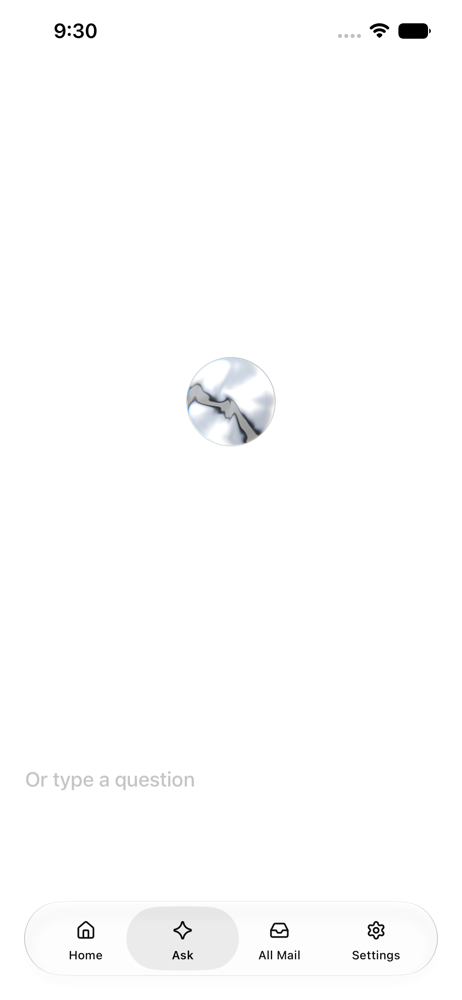
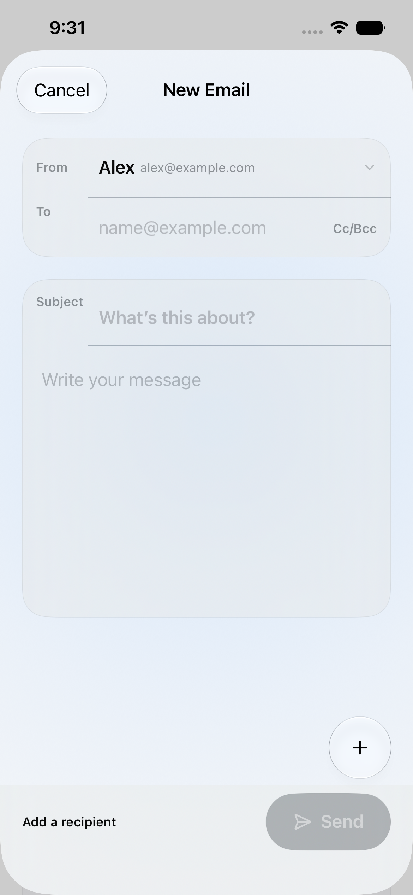
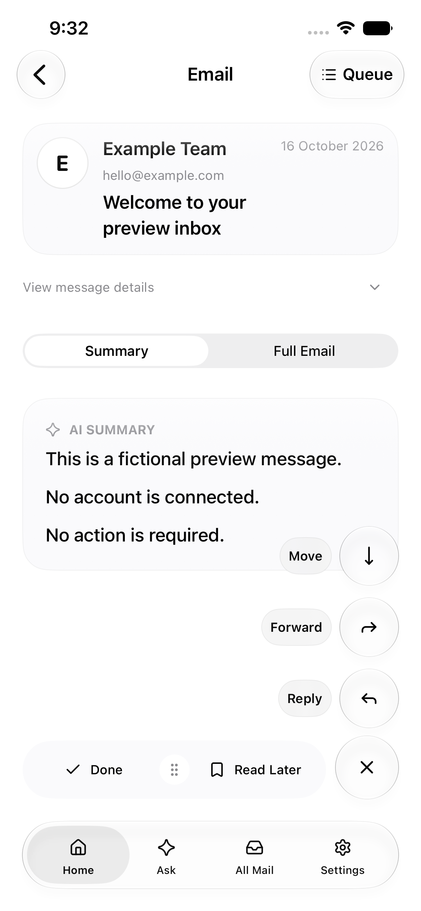
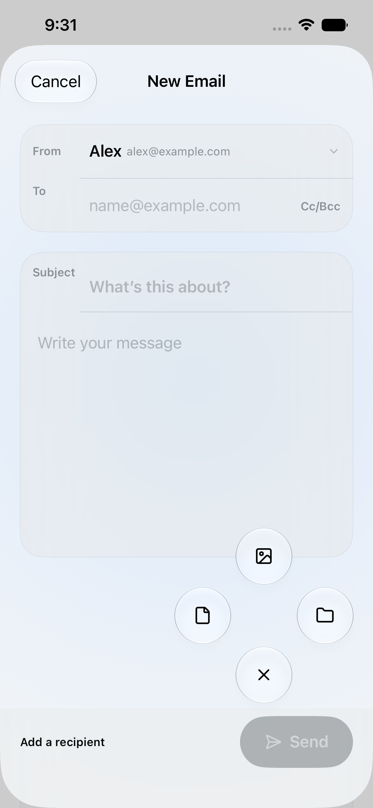
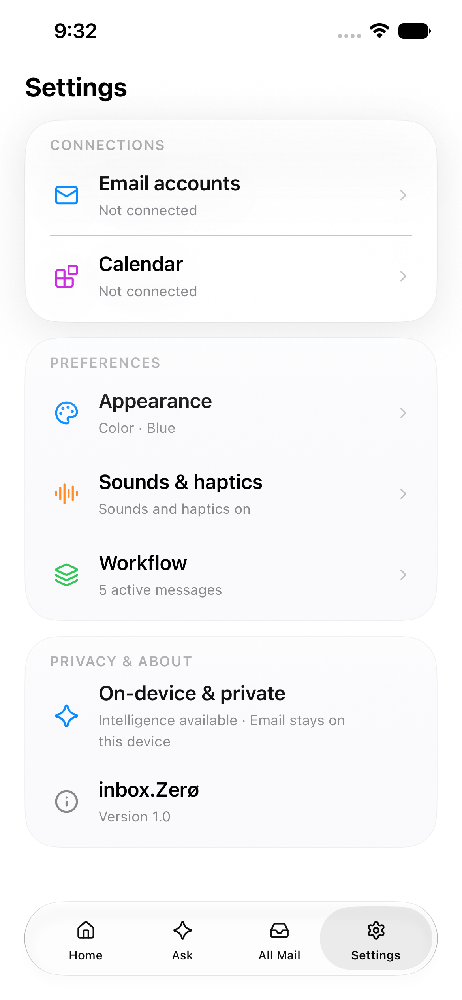

<div align="center">
  
  <h1>inbox.Zer0</h1>
  <p>A native email workspace. A foundation for what comes next.</p>
  <p>SwiftUI · Metal · iPhone · macOS companion · MIT</p>
  <p><a href="#quick-start">Get started</a> · <a href="#inside-the-app">Explore the app</a> · <a href="#start-building">Contribute</a> · <a href="SETUP.md">Setup guide</a></p>
</div>

Turn an inbox into a workflow: **Action, Waiting, Read Later, and Done**. Explore mail, compose a reply, or open Ask—all in a native Apple-platform interface.

Created by **Jason Johnson**, and open for the community to build on.

## Inside the app

| All Mail | Ask | Compose |
| :---: | :---: | :---: |
|  |  |  |
| One library, clear actions | A Metal-rendered starting point | Write, reply, and attach |

<details>
<summary>More screenshots: message actions, attachments, and Settings</summary>

| Message actions | Attachment menu | Settings |
| :---: | :---: | :---: |
|  |  |  |

</details>

Actual screenshots from the sanitized app in a fresh simulator. All displayed messages and addresses are fictional; these do not demonstrate live mail delivery or AI-generated answers. [Screenshot provenance](docs/screenshots/README.md).

### What you can build on

- **Mail workflows:** four triage queues, an All Mail library, and a bottom action rail.
- **Provider infrastructure:** Gmail OAuth and iCloud Mail, starting completely unconfigured.
- **Writing and retrieval:** compose, reply, attachments, and local search.
- **Native intelligence UI:** a Metal Ask orb, dictation integration, and on-device intelligence hooks.
- **Local storage:** protected message storage and runtime Keychain credentials.
- **Companion projects:** a macOS Mail app, MailKit extension, and optional self-hosted push-relay reference.

> **Project status:** a community-development source release, not a turnkey hosted service or production-certified app. No account, API credential, signing identity, mailbox export, or hosted backend is included. The optional relay is not hardened for public multi-user deployment.

## Quick start

### 1. Get the source

```sh
git clone https://github.com/novembernights/inbox-zero.git
cd inbox-zero
open ActionMailApp.xcodeproj
```

You need a Mac with Xcode and an installed iOS simulator runtime. The app uses **iOS 26+ APIs**. The verified environment was **Xcode 27.0 beta (27A5228h)** with an iOS 27 simulator; compatibility with earlier Xcode versions has not been established. Initial Swift package resolution needs internet access.

### 2. Run the preview mailbox

1. Let Xcode resolve the versions in the committed `Package.resolved`.
2. Select the shared **`inbox.Zer0iOS`** scheme.
3. Choose an **iPhone simulator**, not a physical-device destination.
4. Press **⌘R**.

The Debug scheme already enables `-MockUIData`, so you can explore fictional messages without credentials or a backend. Preview messages are UI fixtures, not a test mailbox for sending mail.

To jump to a screen, add an argument under **Product → Scheme → Edit Scheme → Run → Arguments**:

| Argument | Opens |
| --- | --- |
| `-OpenAsk` | Ask and the Metal orb |
| `-OpenAllMail` | Mail library |
| `-OpenCompose` | Composer; use with `-MockUIData` for example senders |
| `-OpenSettings` | Settings |

### 3. Connect your own account—only when ready

Disable `-MockUIData` before connecting real mail. Follow [SETUP.md](SETUP.md) for Gmail OAuth, iCloud app-specific passwords, signing, calendar, and dictation.

- **Gmail:** supply your own OAuth client and matching callback scheme.
- **iCloud:** enter your own email and app-specific password in Settings.
- **Physical iPhone:** choose your own signing team and unique bundle IDs.
- **Push relay:** optional and disabled by default; read [its deployment caveats](relay/README.md) first.

Keep local developer identifiers in ignored `Config/Local.xcconfig`. Never put passwords, bearer tokens, or private keys there or in a committed scheme. [Privacy boundaries](PRIVACY.md) · [Security policy](SECURITY.md).

## Start building

Start with a small, scoped issue or improvement. Good contribution areas include test coverage, accessibility, provider error handling, developer setup, and documentation. Discuss larger changes in an issue first.

1. **Fork** the repository and clone your fork.
2. Create a focused branch, for example `git switch -c feature/search-tests`.
3. Reproduce the behavior with fictional fixtures, then add regression coverage.
4. Run the checks below and review your diff for credentials or identifying data.
5. Open a pull request explaining what changed, why, and exactly what you tested.

For interface changes, include sanitized screenshots at relevant display sizes. Report simulator checks separately from physical-device and live-provider checks. See [CONTRIBUTING.md](CONTRIBUTING.md) for the full guidelines.

### Local checks

From the repository root:

```sh
# Source privacy guardrail (Python 3, no dependencies)
python3 scripts/check_public_export.py

# Fictional search and MIME attachment tests (Xcode command-line tools)
sh scripts/run_smoke_tests.sh

# Unsigned simulator build
xcodebuild -project ActionMailApp.xcodeproj -scheme inbox.Zer0iOS \
  -configuration Debug -sdk iphonesimulator \
  -derivedDataPath build CODE_SIGNING_ALLOWED=NO build
```

<details>
<summary>Optional Python relay tests</summary>

Use a disposable virtual environment. These tests use dummy credentials and mocked Firestore/APNs, not a cloud account.

```sh
python3 -m venv .venv
source .venv/bin/activate
python -m pip install -r relay/requirements.txt
cd relay
python -m unittest -v test_app
```

</details>

### Verification status

iOS Debug/Release and macOS Debug builds passed in the documented toolchain. Search/attachment smoke tests and seven relay tests passed. The app was installed and preview screens inspected in a fresh simulator.

Interactive gestures, accessibility behavior, physical-device recording/intelligence, live provider flows, and notifications still need validation. There is no claim of a complete security audit or CI coverage. See [RELEASE_REVIEW.md](RELEASE_REVIEW.md) for the exact scope and remaining work.

## Find your way around

| Path | Start here for |
| --- | --- |
| [`inbox.Zer0iOS/`](inbox.Zer0iOS/) | iPhone app, providers, search, compose, and UI |
| [`ActionMailApp/`](ActionMailApp/) | macOS companion |
| [`ActionMailMailExtension/`](ActionMailMailExtension/) | MailKit integration |
| [`Config/`](Config/) | Empty public defaults and local configuration template |
| [`relay/`](relay/) | Optional push-relay reference |
| [`scripts/`](scripts/) | Smoke tests and privacy guardrail |
| [`SETUP.md`](SETUP.md) | Account, device, and service setup |

## License & credits

Project contributions and the creator-owned star artwork are released under **MIT**, with attribution to **Jason Johnson**. The Metal orb adapts MIT-licensed Liquid Orb Editor by LerSent001. Dependencies retain their own licenses and notices.

[MIT license](LICENSE) · [Third-party notices](THIRD_PARTY_NOTICES.md) · [Release review](RELEASE_REVIEW.md)

Please keep real email, private account details, credentials, and unredacted screenshots out of commits, issues, and pull requests.
